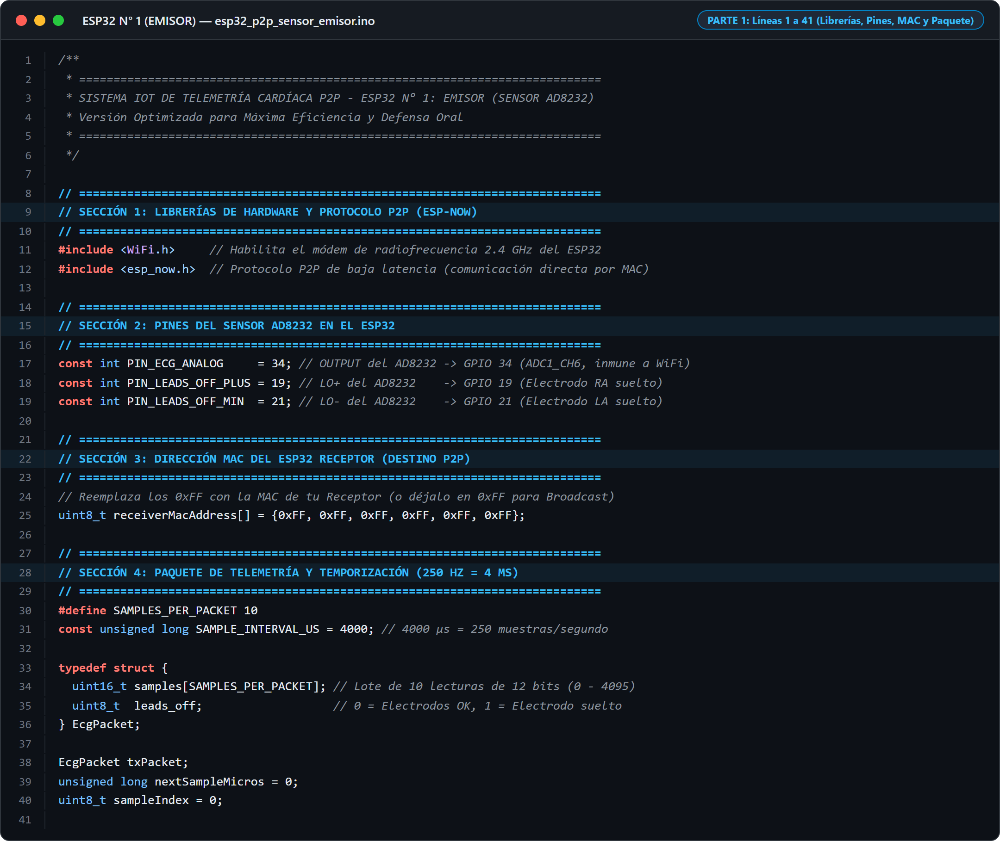
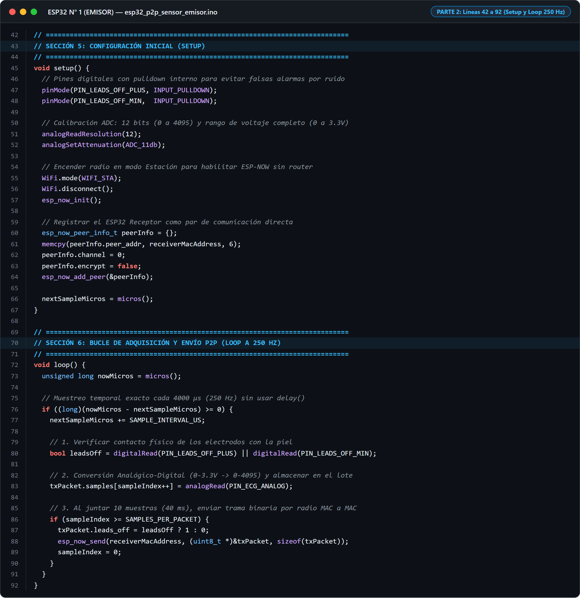
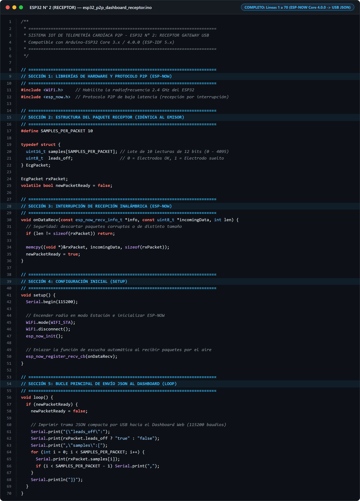
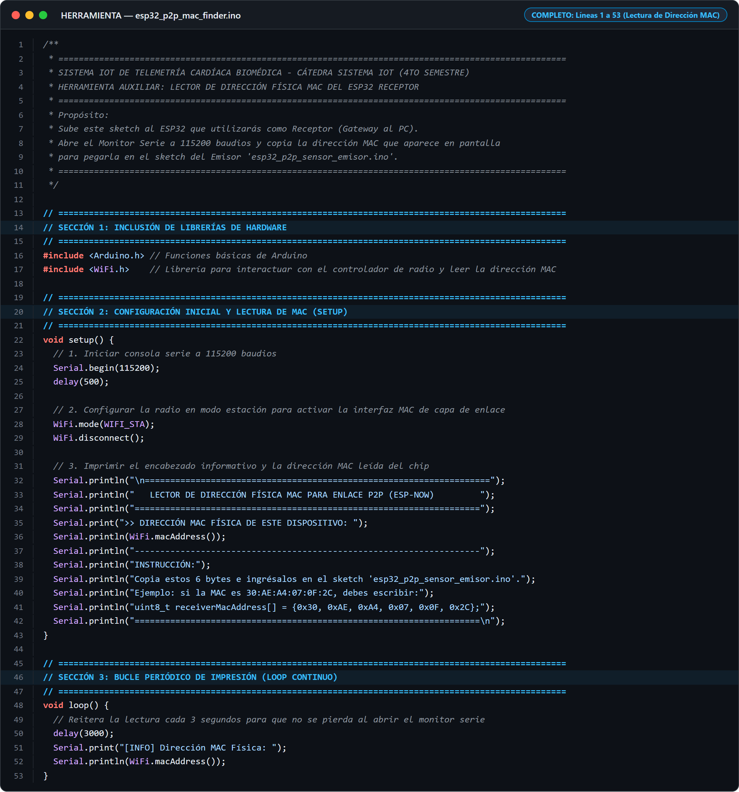

# MANUAL OFICIAL DE TELEMETRÍA CARDÍACA P2P (MAC A MAC)
## Arquitectura Dual ESP32 + Sensor AD8232 + Dashboard Web & Teléfono (GitHub Pages)
**Cátedra: Sistema IoT — 4to Semestre de Ingeniería**

---

## 1. VISIÓN GENERAL DEL SISTEMA (2 ESP32 ENLAZADOS POR MAC)

Este sistema permite capturar la actividad eléctrica real del corazón (**ECG**) en un **ESP32 N° 1 (Emisor)**, transmitirla de forma inalámbrica **punto a punto mediante dirección física MAC (ESP-NOW)** sin usar router Wi-Fi ni Internet hasta un **ESP32 N° 2 (Receptor)** conectado al computador, y visualizar el trazado en tiempo real tanto en la pantalla del computador como en el **teléfono del profesor** mediante un enlace público de GitHub Pages.

```
[PACIENTE (Ra, La, Rl)] ──► [Módulo AD8232] ──(Pines 34, 19, 21)──► [ESP32 N° 1 EMISOR]
                                                                            │
                                                      Radio ESP-NOW 2.4 GHz │ (Trama binaria 22 bytes por MAC)
                                                                            ▼
[TELÉFONO PROFESOR] ◄──(Nube MQTT WSS)── [LAPTOP / DASHBOARD] ◄──(USB 115200)── [ESP32 N° 2 RECEPTOR]
```

---

## 2. ¿CÓMO SE COMUNICAN ENTRE SÍ LOS DOS ESP32 POR DIRECCIÓN MAC?

El protocolo **ESP-NOW** trabaja en la **Capa 2 (Enlace de Datos)** del estándar 802.11 usando la dirección física MAC grabada de fábrica en el chip de cada ESP32 (por ejemplo: `30:AE:A4:07:0F:2C`). No necesita router, IP ni contraseñas Wi-Fi.

### Flujo de Emparejamiento en 3 Pasos:
1. **Paso 1 — Leer la MAC del Receptor (`1_Lector_MAC_Receptor`):** Subes `esp32_p2p_mac_finder.ino` al ESP32 N° 2 y anotas su MAC física de 6 bytes en el Monitor Serie a 115200 baudios.
2. **Paso 2 — Configurar el Destino en el Emisor (`2_ESP32_1_Emisor_Sensor_AD8232`):** En la **Línea 25** de `esp32_p2p_sensor_emisor.ino`, reemplazas `{0xFF, 0xFF, 0xFF, 0xFF, 0xFF, 0xFF}` por la MAC de tu Receptor (ejemplo: `{0x30, 0xAE, 0xA4, 0x07, 0x0F, 0x2C}`).
3. **Paso 3 — Enlace Activo:** El Emisor registra al Receptor con `esp_now_add_peer(&peerInfo)` y transmite lotes de 10 muestras cardíacas cada 40 ms directamente a esa MAC física mediante `esp_now_send(...)`. El Receptor despierta por interrupción (`onDataRecv`) y envía los datos al Dashboard por USB a 115200 baudios.

---

## 3. CONEXIÓN FÍSICA DE PINES (AD8232 ➔ ESP32 N° 1 EMISOR)

| Pin AD8232 | Pin ESP32 | Tipo | Función | Justificación de Ingeniería |
| :--- | :--- | :--- | :--- | :--- |
| **OUTPUT** | **GPIO 34** | Analógico (ADC1) | Señal cardíaca continua | **Obligatorio usar ADC1** porque el ADC2 se bloquea cuando transmite la radio ESP-NOW. Además GPIO 34 es *Input-Only* sin resistencias internas que alteren la microtensión. |
| **LO+** | **GPIO 19** | Digital IN | Detector electrodo derecho | Configurado con `INPUT_PULLDOWN` interno para evitar falsas alarmas por ruido de 50 Hz. |
| **LO-** | **GPIO 21** | Digital IN | Detector electrodo izquierdo | Configurado con `INPUT_PULLDOWN` interno. |
| **3.3V** | **3V3** | Alimentación | +3.3 Vcc | **¡NUNCA conectar a 5V!** El sensor y los pines del ESP32 operan a 3.3V máximo; 5V daña el conversor ADC. |
| **GND** | **GND** | Masa común | 0V de referencia | Plano equipotencial necesario para cancelar interferencia eléctrica. |

*(Nota: El **ESP32 N° 2 Receptor** NO lleva ningún sensor conectado; va conectado únicamente por cable USB al computador).*

---

## 4. TRANSFORMACIÓN DE LA SEÑAL CARDÍACA (DEL PECHO A LA PANTALLA)

1. **Biopotencial (0.5 a 2 mV):** Los 3 electrodos (Derivación I de Einthoven: RA, LA, RL) captan el pulso eléctrico del miocardio.
2. **AD8232 (0 a 3.3 V):** Amplifica la señal **x100**, aplica un filtro analógico pasa-banda (0.5–40 Hz) y centra la onda en **1.65 V**.
3. **Conversión ADC 12 bits (0 a 4095):** En el ESP32 Emisor, `analogRead(34)` digitaliza el voltaje cada **4000 µs (250 Hz exactos con `micros()`)**: $V = \frac{\text{ADC}}{4095} \times 3.3\text{ V}$.
4. **Paquete Binario P2P (22 bytes):** Agrupa 10 muestras (`samples[10]`) + estado de parches (`leads_off`) y los envía vía ESP-NOW 25 veces por segundo (ahorrando 90% de tráfico).
5. **Gateway USB (JSON):** El ESP32 Receptor imprime por puerto serie a 115200 baudios: `{"leads_off":false,"samples":[2048,2060,...]}`.
6. **Dashboard + Teléfono (WebSerial + Cloud MQTT):** El laptop lee el USB, dibuja el ECG a 60 FPS con filtro DSP y Pan-Tompkins, y retransmite automáticamente los datos a la nube (`wss://broker.emqx.io`) para que el profesor los vea en vivo desde su teléfono.

---

## 5. ESP32 N° 1: EMISOR (`esp32_p2p_sensor_emisor.ino`) — LÍNEA POR LÍNEA

### Parte 1: Librerías, Pines, Dirección MAC y Paquete (Líneas 1 a 41)


| Línea | Código | Explicación Literal |
| :--- | :--- | :--- |
| **11** | `#include <WiFi.h>` | Activa el módem de radiofrecuencia de 2.4 GHz del ESP32. |
| **12** | `#include <esp_now.h>` | Importa el protocolo inalámbrico P2P ESP-NOW de baja latencia (< 2 ms). |
| **17** | `const int PIN_ECG_ANALOG = 34;` | Asigna el GPIO 34 (ADC1_CH6) a la señal analógica `OUTPUT` del sensor AD8232. |
| **18** | `const int PIN_LEADS_OFF_PLUS = 19;` | Asigna el GPIO 19 al pin digital `LO+` (electrodo derecho suelto). |
| **19** | `const int PIN_LEADS_OFF_MIN = 21;` | Asigna el GPIO 21 al pin digital `LO-` (electrodo izquierdo suelto). |
| **25** | `uint8_t receiverMacAddress[] = {...};` | Guarda la **MAC física de 6 bytes del ESP32 Receptor**. Con `0xFF` difunde a cualquiera; con la MAC real comunica punto a punto exclusivo. |
| **30** | `#define SAMPLES_PER_PACKET 10` | Empaqueta 10 lecturas por envío para no saturar la radio ni el puerto USB. |
| **31** | `const unsigned long SAMPLE_INTERVAL_US = 4000;` | Establece un muestreo de 1 lectura cada **4000 microsegundos** (4 ms = **250 Hz**). |
| **33–36** | `typedef struct { uint16_t samples[10]; uint8_t leads_off; } EcgPacket;` | Estructura binaria del paquete: 10 enteros de 16 bits (`0–4095`) + 1 byte que avisa si hay electrodos sueltos (`1` o `0`). |
| **38–40** | `EcgPacket txPacket; nextSampleMicros; sampleIndex;` | Variables globales en RAM para armar el paquete, controlar el reloj y contar de 0 a 9. |

### Parte 2: Configuración `setup()` y Muestreo `loop()` a 250 Hz (Líneas 42 a 92)


| Línea | Código | Explicación Literal |
| :--- | :--- | :--- |
| **45–48** | `void setup() { pinMode(..., INPUT_PULLDOWN);` | Configura los pines 19 y 21 con resistencia *pulldown* interna para evitar ruido flotante. |
| **51–52** | `analogReadResolution(12); analogSetAttenuation(ADC_11db);` | Calibra el ADC a 12 bits (`0–4095`) y rango completo de voltaje `0–3.3 V`. |
| **55–57** | `WiFi.mode(WIFI_STA); WiFi.disconnect(); esp_now_init();` | Enciende la radio en modo Estación (sin conectar a router) e inicia ESP-NOW. |
| **60–64** | `esp_now_peer_info_t peerInfo... esp_now_add_peer(&peerInfo);` | Registra la MAC del Receptor en la tabla de destinatarios P2P sin cifrado para máxima velocidad. |
| **66** | `nextSampleMicros = micros();` | Inicializa el cronómetro de precisión en microsegundos. |
| **72–77** | `if ((long)(nowMicros - nextSampleMicros) >= 0) { nextSampleMicros += 4000; }` | Ejecuta el bloque exactamente cada 4 ms (250 Hz reales) sin detener el procesador con `delay()`. |
| **80** | `bool leadsOff = digitalRead(19) \|\| digitalRead(21);` | Revisa si alguno de los parches se despegó de la piel. |
| **83** | `txPacket.samples[sampleIndex++] = analogRead(PIN_ECG_ANALOG);` | Convierte el voltaje del corazón en un entero (`0–4095`), lo guarda en el lote y avanza el índice. |
| **86–90** | `if (sampleIndex >= 10) { esp_now_send(...); sampleIndex = 0; }` | Al completar 10 lecturas (40 ms), envía el paquete directo por radio a la MAC del Receptor y reinicia el índice. |

---

## 6. ESP32 N° 2: RECEPTOR (`esp32_p2p_dashboard_receptor.ino`) — LÍNEA POR LÍNEA



| Línea | Código | Explicación Literal |
| :--- | :--- | :--- |
| **11–12** | `#include <WiFi.h>` / `#include <esp_now.h>` | Activa el hardware de radiofrecuencia 2.4 GHz y las funciones de recepción ESP-NOW. |
| **17–22** | `#define SAMPLES_PER_PACKET 10` / `typedef struct ... EcgPacket;` | Declara la misma estructura exacta de paquete que el Emisor para interpretar cada byte sin errores. |
| **24–25** | `EcgPacket rxPacket; volatile bool newPacketReady = false;` | `rxPacket` almacena los datos entrantes; `newPacketReady` es una bandera segura (`volatile`) que avisa al `loop()` cuando llegó un paquete nuevo. |
| **30** | `void onDataRecv(const esp_now_recv_info_t *info, const uint8_t *incomingData, int len)` | Interrupción moderna oficial para ESP32 Core 3.x/4.0.0 que despierta automáticamente al recibir una trama de radio. |
| **32** | `if (len != sizeof(rxPacket)) return;` | **Escudo de seguridad:** si llega un paquete corrupto o ajeno con tamaño diferente, lo descarta de inmediato. |
| **34–35** | `memcpy(&rxPacket, incomingData, sizeof(rxPacket)); newPacketReady = true;` | Copia los bytes entrantes en microsegundos y levanta la bandera `newPacketReady` para no bloquear la tarea de radio Wi-Fi. |
| **41–51** | `void setup()` (`Serial.begin(115200); ... esp_now_register_recv_cb(onDataRecv);`) | Abre el puerto USB a 115200 baudios, inicia ESP-NOW en modo Estación y registra la interrupción de escucha. |
| **56–69** | `if (newPacketReady) { ... Serial.println("]}"); }` | En el bucle principal, cuando llega un paquete nuevo, construye e imprime por USB la trama JSON `{"leads_off":false,"samples":[...]}` que lee el Dashboard Web. |

---

## 7. HERRAMIENTA LECTOR MAC (`esp32_p2p_mac_finder.ino`)



* **Uso:** Se sube temporalmente al **ESP32 N° 2 (Receptor)** para leer con `WiFi.macAddress()` (Línea 36) sus 6 bytes de dirección física en el Monitor Serie (115200 baudios). Luego se copia esa MAC en la Línea 25 del **Emisor** y finalmente se carga el programa definitivo del Receptor en el ESP32 N° 2.

---

## 8. SUBIR A GITHUB PAGES Y VER EN EL TELÉFONO DEL PROFESOR

1. Sube todo el contenido de la carpeta `PAQUETE_ENTREGA_COMPAÑEROS` a un repositorio público de GitHub (el archivo `index.html` ya está en la raíz).
2. En GitHub entra a **Settings -> Pages -> Branch: main / root -> Save**. En 1 minuto obtendrás tu enlace HTTPS (`https://tu-usuario.github.io/tu-repo/`).
3. **El día de la evaluación:**
   * En tu **Notebook:** Abre el enlace de GitHub Pages en Chrome o Edge, abre el menú `☰ MENÚ` y presiona **`🔌 Conectar USB`** eligiendo tu ESP32 N° 2 Receptor.
   * En el **Teléfono del Profesor:** Comparte ese mismo enlace. El dashboard en el celular se conecta automáticamente en modo escucha por nube MQTT (`wss://broker.emqx.io`) y dibuja en tiempo real la misma señal ECG, latidos LPM y corazón 3D sin cables.
